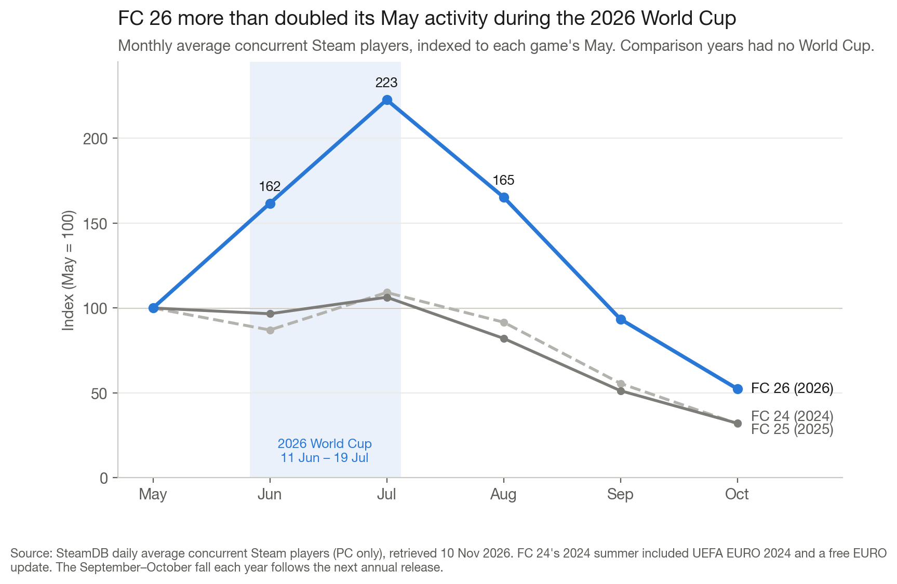
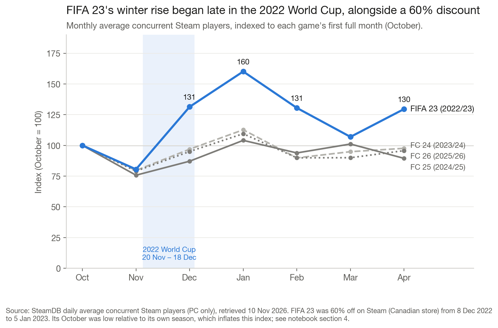
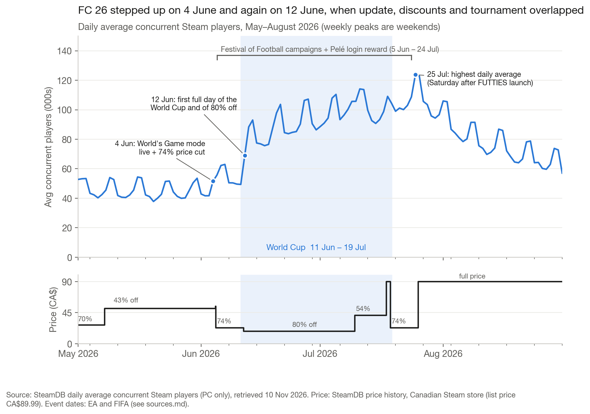

# The World Cup Effect: EA SPORTS FC player activity on Steam

Do FIFA World Cups bring unusual activity to EA's football games, and what could that mean for how EA plans tournament content, pricing and the weeks after a big event? I compared the 2022 and 2026 World Cups with non-World-Cup years using public Steam data. Then I lined up daily activity against tournament milestones, EA's in-game events and Steam price changes.

**Tools:** Python, pandas and Matplotlib in one notebook ([notebooks/analysis.ipynb](notebooks/analysis.ipynb)).

## Method

- **Data:** daily average concurrent Steam players for FIFA 23, FC 24, FC 25 and FC 26 (SteamDB, Sep 2022 – Oct 2026, no missing days), plus SteamDB price history for FC 26 and FIFA 23 (Canadian store). Monthly figures match Steam Charts to within 0.5% in a typical month. Event dates come from EA and FIFA ([sources.md](sources.md)).
- **Concurrent players** means how many people were in the game at the same time. It is not unique players, sales or retention, and it covers PC only.
- **Comparison years:** each World Cup year is compared with the same point in other annual editions' release cycles. These are observational comparisons, not a controlled experiment.
- **Indexing:** each game is scaled to its own baseline month (May for summer; October, the first full month after launch, for winter).
- **Seven-day event comparisons:** for an event on day D, the average of D−7 to D−1 is compared with D+1 to D+7. The event day is excluded, and each window covers every weekday once. The same dates in earlier years serve as a seasonal benchmark.

## Research Questions & Findings

### 1. Do World Cup periods coincide with unusually high activity?

**Both did, but the 2026 evidence is much stronger.**



- **2026:** FC 26's July activity was **223% of its May level**, against 109% (FC 24) and 106% (FC 25). With a March–May baseline the gap holds (235 vs 111–122).
- **2022:** FIFA 23 reached 131 in December and 160 in January (October = 100), against 87–97 and 104–113 for the other games. But its October was unusually low. Compared with its own *post-tournament* February–April level as a sensitivity check, its December is only slightly above the others (107 vs 92–103).



**Why it matters:** the 2026 result holds under both baselines. The 2022 result depends on the reference period, and FIFA 23 stayed elevated into spring, long after the final.

### 2. When did activity increase?

**In two steps: when EA's tournament content went live (4 June), and on the first full day of both the tournament and the 80% discount (12 June).**



- **4 June:** the World's Game mode went live and the price dropped to 74% off. The Festival of Football campaigns and Pelé login reward started the next day. Activity rose **21%** over the following week; the same dates in 2025 and 2024 fell 2–3%.
- **11–12 June:** kick-off was on 11 June, and the price fell to 80% off at 17:12 UTC that day. The daily average went from 49,371 (11 June) to 69,071 (12 June) and about 91,000 that weekend. That is **+45%** over seven days, against −5% on the same dates in earlier years.

**Uncertainty:** kick-off and the deeper discount fell on the same day, so the data shows timing, not cause.

### 3. How did Steam discounts relate to activity?

**Discounts lined up with the biggest increases, but depth alone doesn't explain June.**

- Earlier 2026 discounts of 68–70% came with **+13%** (5 March), +2% (7 April) and 0% (23 April).
- The move from 74% to 80% off (CA$23 to CA$17.99) came with +45%. The largest seven-day increases in FC 26's history are all centred on 9–14 June, peaking at +51%; the next-largest is +36%.
- In 2022, FIFA 23's biggest step came on 9 December, the day after a **60% discount** began. Kick-off came with only +10%.

**Uncertainty:** both World Cups overlapped deep discounts, new content and possibly store featuring or marketing, so the discount's own effect can't be isolated.

### 4. Did elevated activity persist afterwards?

**For a few weeks, yes. It then fell faster than usual in relative terms, but from a much higher level.**

- The week after the final rose 9%. When full price returned on 25 July, the following week was flat; the same weeks in earlier years fell by up to 10%.
- The **highest daily average (123,738) was on Saturday 25 July**, the day after the Festival of Football ended and EA's next promotion (FUTTIES) launched. Sunday 26 July set the all-time peak of 160,728 concurrent players.
- **Relative decline:** October was 24% of July for FC 26, against 29–30% in earlier years. **Absolute level:** FC 26 still ended October at 52% of its May level, against 32%. FC 27 launched on 24 September 2026.

**Uncertainty:** the higher level could reflect new 80%-off buyers or existing players playing more. Concurrent counts don't measure retention.

### 5. What could EA investigate or test?

**Observed:** the largest increases lined up with content launches and price cuts during the tournament. The busiest weekend followed new content released right after the tournament campaigns ended.

**Proposed tests** (these need EA's internal data):

1. **Promotional timing:** compare regions or platforms where discount timing differed, or use regional holdouts, to separate price from tournament interest.
2. **Discounted-player cohorts:** compare 30/60/90-day retention and spending of 80%-off buyers with full-price buyers.
3. **Post-tournament engagement:** test whether launching new content as tournament campaigns end reliably slows the post-event drop.

## Limitations

- PC (Steam) only; console players aren't covered.
- Two World Cups only, so the results are descriptive with no significance testing.
- The comparison years aren't clean: summer 2024 had UEFA EURO 2024, and FC 24 and FC 25 price histories weren't collected.
- The 2022 result is sensitive to the baseline month, and prices are from the Canadian store.

## Reproduce

SteamDB doesn't allow its data to be republished, so the raw files aren't included. [data/raw/README.md](data/raw/README.md) explains how to download them, with checksums. Then run:

```bash
pip install -r requirements.txt
jupyter nbconvert --to notebook --execute --inplace notebooks/analysis.ipynb
```

The committed notebook keeps its outputs, so the results can be read without re-running it.
